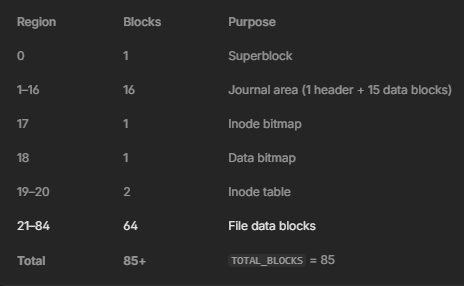

#Project overview
This is a user-space journaling layer for a toy virtual file system (a "VSFS" image), written in C11. It implements a write-ahead log (WAL) with atomic transactions on top of a fixed-layout disk image.

Files
journal.c — the core journaling implementation (178 lines)
test_journal.c — test harness that exercises the journal API
Makefile — builds test_journal with cc -O2 -Wall -Wextra -std=c11
vsfs.img — a 348 KB disk image (86 blocks × 4096 bytes) with a valid superblock (SFSV magic)
mkfs, validator — prebuilt helper binaries
journal.o, test_journal.o — leftover object files

#How the journal works (journal.c)
Classic write-ahead logging with 3-phase commit:

journal_begin() — start a transaction (only one at a time)
journal_log_write(blockno, data) — buffers up to 15 block writes in memory (tx_payload) with target block numbers
journal_commit() — the atomic sequence:
Write journal header with committed=0 + fsync
Write all payload blocks into the journal area + fsync
Set committed=1 in header + fsync ← the atomic "commit point"
install_transaction() — replay journal blocks to their home locations + fsync
Zero the header + fsync
journal_recover() — on open, checks the journal header: if committed=1 and valid, replays the logged blocks to home locations (crash recovery); then clears the journal. This is idempotent — safe to call anytime.
journal_open() validates the superblock magic/block size/total block count before accepting the image.

